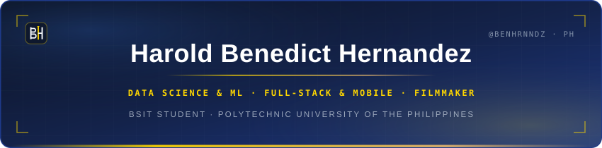
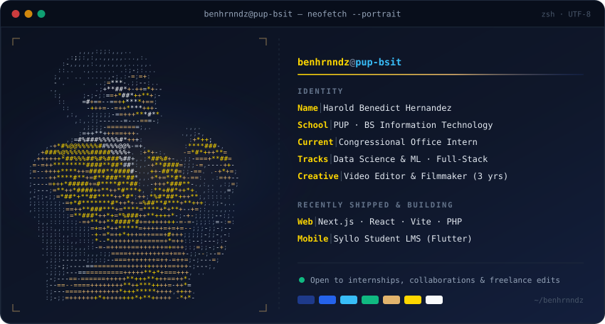

<div align="center">
  
</div>

<p align="center">
  <a href="https://benhrnndz-vid-editor.vercel.app">
    
  </a>
  &nbsp;
  <a href="https://www.linkedin.com/in/haroldhernandez-it/">
    
  </a>
  &nbsp;
  
  &nbsp;
  
</p>

<br />

<div align="center">
  
</div>

<details>
  <summary><sub><code>&gt;_</code> View raw copyable ASCII portrait</sub></summary>

```text
                 ..
           .,:,,::;:,,,....
         ,;;;:,:..,,,,,...:.
        ,:,. .,,.,..  ,:;:,..
       :, ....... .:-,,-=;=-.
       ;        .,-+#*=,;;=-:,.
       ,.     ..:;+***#*=+++*=-,
       .;.   :*==-:-==**#*+++-,.
         ;.   =*++--==+****++=
          :,.  ;-;;;-=++++****;
           .:,.,:;----=---=--;.
             ,----=======-,        .,,,
           .-*#*#####*+++=         ..;+=-.
      :-=*#%%%%%%#%%@@%#=+-         ;***##+:.
    -*##%%%%%%%#####%%%*,.;++=;,   .=+***+***:
   -++++***##%##########+,.-*##%*=::;;-==+++**:
  ;=-+++****++*###**##*##;..-*+####-:;-+,,;-=++:
 .=--=++******==#*####*##+..;*=+#**=--=-. .-+*==.
 .----=++**####=+#***#**#*,.,+++*###*+:,,,  :;--.
  :---;=**+**###++**+*#***= .+*+*#*+**; ,:,. ;-.
  ;;;;;;=*#**********+*#*;++=##****+***=:::;:,.
 .;::::;:-=+****##***++*+=+##******++++=;.:::..
   :::::::-+***##***+=####=***+*+*=--=-;;;,;::,
   ,:,:::::;=++*+++***##*#=+++++++--==;;;;-+;;-
   .;::,,::::;;=+=+*+*****=++++++++=-;;;-;;-;-,
    :;;;:,,::::-*-+*=+++++++====*=+=;;;;-;-;:-
     :;:;;:,,:::+--*+++++=++=+==*=+=:;-;;--;=,
     :::;::;:,,,,;;-=====++++++=+==+;;--;--=-
     .:;;---;;;;::;-===+++++++++==++-;;----;
      :;-;-----========+++++++++==++=;;;;:.
     .;;;----=========+++++*+*+===++=  .
     .-----=====+++++++*++++*+++==++*,
     ,;-=-=====+++++++*++****++++;++*;
     ,;-;-+++++++++++++++*+**++++.=*++.
```

</details>

---

## Tech Stack

| Category | Technologies |
| :--- | :--- |
| **Languages** |          |
| **Web & Mobile** |        |
| **Data & ML** |   |
| **Databases, Cloud & Tools** |       |
| **Multimedia** |   |

---

## GitHub Activity

<p align="center">
  
</p>

---

## Connect

<p align="center">
  <a href="https://benhrnndz-vid-editor.vercel.app"></a>
  &nbsp;
  <a href="https://www.linkedin.com/in/haroldhernandez-it/"></a>
  &nbsp;
  <a href="https://github.com/benhrnndz"></a>
  &nbsp;
  <a href="https://www.youtube.com/@ben_hrnndz"></a>
  &nbsp;
  <a href="https://www.instagram.com/ben_hrnndz/"></a>
  &nbsp;
  <a href="https://www.tiktok.com/@ben_hrnndz"></a>
  &nbsp;
  <a href="https://www.facebook.com/benhrnndz"></a>
  &nbsp;
  <a href="mailto:haroldbenedicthernandez@gmail.com"></a>
</p>

<p align="center"><em>Open to internships, collaborations, meaningful data problems, and creative multimedia projects.</em></p>
